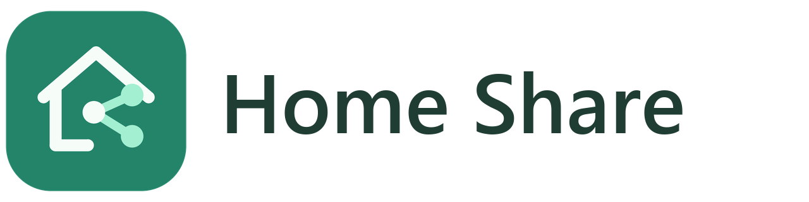

<picture>
  <source media="(prefers-color-scheme: dark)" srcset="custom_components/home_share/brand/dark_logo@2x.png">
  
</picture>

# Home Share

A calmer way to manage what Google Home can see in Home Assistant.

Search your devices, share them in bulk, and set familiar names, rooms and aliases in one clean panel. Review changes, apply them live, and request a Google sync—without restarting Home Assistant for routine edits. Every save creates a recovery snapshot.

**Uses your existing manual Google Assistant connection. No subscription, Nabu Casa account, new cloud service, or new credentials.** Home Share is an independent community project and is not affiliated with Google or Home Assistant.

## What it does

- Imports the existing entity mapping exactly, including entries for missing or disabled devices.
- Shows devices supported by Home Assistant's Google integration, plus all previously configured entries.
- Filters by room/area, sharing and availability; searches names, aliases and entity IDs.
- Edits Google names, room hints and aliases without renaming entities in Home Assistant.
- Reviews individual and bulk changes before applying them.
- Updates the running manual Google configuration and the included YAML file together.
- Requests a Google HomeGraph sync and reports whether Google accepted it.
- Preserves snapshots before edits, with preview before restoration.
- Restricts configuration APIs and the panel to Home Assistant administrators.

## Requirements

Home Assistant **2026.10.0 or newer**; tested with **2026.10.2**. A working manual `google_assistant` integration is required. Home Share does not create a Google Cloud project or replace Google account linking.

The Google configuration must explicitly share selected entities:

```yaml
google_assistant:
  project_id: YOUR_EXISTING_PROJECT
  service_account: !include YOUR_EXISTING_SERVICE_ACCOUNT_FILE.json
  report_state: true
  expose_by_default: false
  entity_config: !include google_assistant_entities.yaml
```

Keep your existing connection settings and credentials. The example only shows the required structure. The entities filename must be a plain YAML filename at the root of `/config`.

If your entities are inline, move **only their mapping** into the included file and restart Home Assistant once before setting up Home Share. Do not add an `entity_config:` wrapper in that file. Back up your configuration first. Do not run a second exposure manager that writes the same file.

## Install through HACS

1. In HACS, add `https://github.com/spikked27/home-share-ha` as a custom repository, category **Integration**.
2. Download **Home Share** and restart Home Assistant once to discover the integration.
3. Go to **Settings → Devices & services → Add integration → Home Share**.
4. Open **Home Share** in the sidebar.

Installation may need one restart. Sharing edits made afterward do not.

## Use

Toggle sharing or select several devices for a bulk change. Open a device to edit its Google name, suggested room and other names. Select **Review changes**, check the differences, then **Apply & sync**. Drafts stay in the current browser until applied or discarded; refreshing warns before discarding them.

Google can take time to refresh its device list after accepting a sync. Existing room assignments in the Google Home app may take priority over room hints. Unsupported or unavailable entities cannot be made discoverable by this panel; their saved settings are retained for when Home Assistant provides them again.

**History** shows the 30 most recent snapshots. Restoring one previews the differences and creates a fresh snapshot before applying. Older backups remain on disk; Home Share does not delete them automatically. Snapshots contain entity names and rooms: treat them as private household data.

If Google sync fails, the settings are still saved and live locally. Use **Sync Google** to retry. If another tool edits the file, Home Share refuses to overwrite that change; reload the native Google Assistant integration (or restart HA) and refresh the panel before continuing.

## Compatibility and recovery

Home Assistant has no public reload API for the manual Google entity mapping. Home Share isolates and checks the current `GoogleConfig` interface, changes only `entity_config`, and clears the supported-entity cache. If that interface changes, setup and edits fail with an explanation rather than guessing. Recheck compatibility before upgrading Home Assistant across major releases.

The entity YAML remains valid for native Google Assistant after Home Share is removed. Uninstalling Home Share does not remove shared entities or credentials. To recover manually, copy an appropriate snapshot from `/config/backups/home_share/` over the included entities file and restart Home Assistant. Files are replaced atomically and external changes are checked before writing. A runtime failure during an apply restores the previous YAML and mapping.

## Development

```sh
python -m pip install homeassistant==2026.10.2
python -m unittest discover -s tests -v
python -m unittest discover -s integration_tests -v
node --check custom_components/home_share/frontend/home-share.js
python scripts/package.py
```

Pure model/storage tests need PyYAML only. Native runtime integration tests need a supported Linux Home Assistant environment and Python 3.14. The frontend uses native custom elements, local assets and Home Assistant's WebSocket connection; no build tools or CDN are needed.

See [CONTRIBUTING.md](CONTRIBUTING.md) and [SECURITY.md](SECURITY.md). MIT licensed.

Original SVG artwork and light/dark PNG logos are included in `custom_components/home_share/brand/`. Regenerate the exports with `python scripts/generate_brand.py` (development dependency: Pillow). Release packaging checks that every required platform image is present.

Home Assistant uses the bundled `brand/` images. Legacy HACS 2.0.5 ignores these images and still uses its obsolete CDN. In **Settings → Devices & services → Home Share → Configure**, an optional compatibility switch redirects only Home Share's icon/logo URL to its bundled artwork. It recognizes only the known 20250128065759 HACS frontend, backs up original JavaScript and gzip files under `/config/backups/home_share/hacs_branding/`, and restores matching patched files when disabled or Home Share is removed. It never replaces assets changed by another tool. Other HACS versions and Marketplace are left untouched. Reload the HACS browser page after changing the option.
